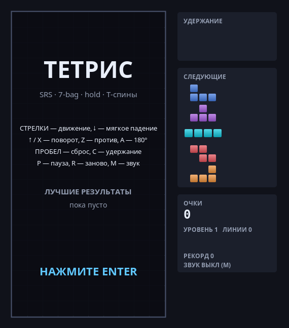
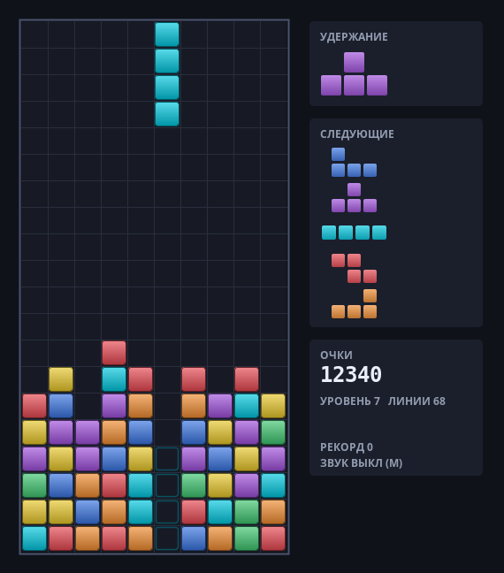
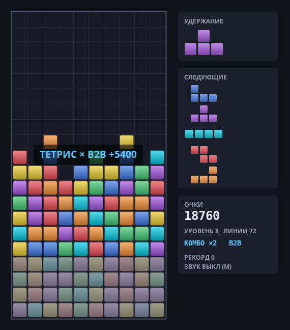

# 🧱 Тетрис (Java)

Классический **Тетрис** на Java Swing по правилам Tetris Guideline: SRS с wall kick,
7-bag, удержание фигуры, призрачная фигура, T-спины и комбо — без внешних зависимостей,
звуки синтезируются на лету.


## Скриншоты

| Меню и рекорды | Игровой процесс | Тетрис + комбо |
|---|---|---|
|  |  |  |
| Управление, таблица лучших результатов | Стек, колодец, призрачная фигура, очередь фигур | Вспышка очищенных рядов, подпись и бонус back-to-back |

## Возможности

- **SRS (Super Rotation System)** — корректные повороты с wall kick, включая пьедесталы для I-фигуры
- **7-bag** — все семь фигур выдаются по одному разу перед перемешиванием
- **Hold** — удержание фигуры, один обмен за фигуру
- **Призрачная фигура** — место приземления видно заранее
- **Lock delay 500 мс** со сбросом при смещении/повороте (до 15 раз)
- **DAS 150 мс / ARR 40 мс** — привычное ускоренное движение
- **T-спины** (полные и mini), **комбо**, **back-to-back**, **идеальная очистка**
- **Рекорды** — топ-5 результатов в `~/.tetris-java/scores.txt`
- **Синтезированный звук** — короткие тоны через `javax.sound`, файлов ресурсов нет
- Отрисовка на Swing + `Graphics2D`, зависимости — только JDK

## Управление

| Клавиша | Действие |
|---------|----------|
| ← / → | движение (с автоповтором) |
| ↓ | мягкое падение, +1 очко за клетку |
| ↑ или X | поворот по часовой |
| Z или Ctrl | поворот против часовой |
| A | поворот на 180° |
| SPACE | сброс вниз, +2 очка за клетку |
| C или Shift | удержание (hold) |
| P / ESC | пауза |
| R | начать заново |
| M | звук вкл/выкл |

Дубликаты для левой руки: `H` `J` `L` вместо стрелок.

## Правила и очки

- Поле **10×20**, фигура спавнится в колонках 3..5 (I — 3..6), наполовину над полем
- Уровень растёт каждые 10 линий (до 20-го), гравитация — формула Tetris Worlds:
  `(0.8 − 0.007·(level−1))^(level−1)` секунд на строку

| Событие | Очки (× уровень) |
|---------|------------------|
| 1 / 2 / 3 / 4 линии | 100 / 300 / 500 / 800 |
| T-спин без линий / 1 / 2 / 3 линии | 400 / 800 / 1200 / 1600 |
| T-спин mini без линий / 1 / 2 линии | 100 / 200 / 400 |
| Комбо | +50 × номер комбо × уровень |
| Back-to-back (тетрис или спин подряд) | ×1.5 |
| Идеальная очистка (поле пустое) | 2000 / 3000 / 4000 / 5000 |

Проигрыш — фигура не помещается при спавне либо зафиксирована целиком над полем (lock out).

## Системные требования

- **JDK 17+** — сборка и запуск
- **Linux x86_64** — для нативной сборки через `jpackage`
- X11/Wayland для графического окна

## Готовые сборки

Релиз: [v1.0.0](https://github.com/dzolotarev/tetris-java/releases/tag/v1.0.0)

| Файл | Описание |
|------|----------|
| `tetris-java-1.0.0.jar` | Универсальный JAR, нужна только Java 17+ |
| `tetris-java-1.0.0-linux-x64.tar.gz` | Нативный app-image с урезанным JRE внутри (jpackage/jlink, ~62 МБ) — Java на машине не нужна |

```bash
tar xzf tetris-java-1.0.0-linux-x64.tar.gz
./Tetris/bin/Tetris
```

## Сборка и запуск

### Вариант 1: Gradle (рекомендуется)

```bash
# JAR
./gradlew jar
java -jar build/libs/tetris-java-1.0.0.jar

# Нативный app-image
./gradlew nativeImage
./build/jpackage/Tetris/bin/Tetris

# Он же в tar.gz для релиза
./gradlew packageDist
# Результат: build/dist/tetris-java-1.0.0-linux-x64.tar.gz
```

`jpackage` берётся из `PATH`, либо из переменной `JPACKAGE=/path/to/jdk/bin/jpackage`.
Тип пакета — `JP_TYPE=app-image` (по умолчанию).

### Вариант 2: напрямую через javac

```bash
javac -d out src/main/java/tetris/*.java
java -cp out tetris.Game
```

или `./run.sh`.

## Структура проекта

```
tetris-java/
├── docs/                     # скриншоты для README и релиза
├── src/main/java/tetris/
│   ├── Game.java             # окно и точка входа
│   ├── GamePanel.java        # игровой цикл, ввод, отрисовка
│   ├── Board.java            # поле, фиксация фигур, очистка рядов
│   ├── Tetromino.java        # активная фигура: тип, поворот, позиция
│   ├── Shapes.java           # формы: задан спавн, повороты считаются поворотом матрицы
│   ├── KickTable.java        # wall kick таблицы SRS
│   ├── Bag.java              # генератор 7-bag
│   ├── Score.java            # очки, уровни, T-спины, комбо, back-to-back
│   ├── HighScore.java        # топ-5 рекордов в ~/.tetris-java/scores.txt
│   └── Sound.java            # синтезированные звуки (PCM на лету)
├── build/dist/               # готовые сборки (вне git)
├── LICENSE                   # MIT
├── build.gradle              # Gradle: jar + jpackage
├── settings.gradle           # имя проекта
├── gradlew                   # Gradle wrapper
└── run.sh                    # быстрый запуск через javac
```

## Архитектура

- **Game loop**: `javax.swing.Timer(16 мс)` ≈ 60 FPS, логика считается по дельте `System.nanoTime()` (ограниченной 100 мс), поэтому скорость не зависит от просадок отрисовки
- **Гравитация**: аккумулятор времени + формула Tetris Worlds, поэтому уровень меняет скорость без пересборки цикла
- **Повороты**: `Shapes.cells(type, rot)` — спавн-матрица поворачивается по часовой; `KickTable` даёт смещения SRS уже в экранных координатах (Y вниз)
- **T-спин**: проверяются 3 угла вокруг центра T; полный/mini различаются по тому, какие именно углы заняты и каким киком закончился поворот
- **Очистка рядов**: `Board.fullRows()` → панель рисует вспышку `clearingRows` 240 мс, затем `Board.clearRows()` сдвигает стек
- **Звук**: PCM-буфер с синусом и огибающей, играется через `Clip` — файлов ресурсов нет
- **Рекорды**: текстовый файл `~/.tetris-java/scores.txt`, топ-5 по очкам

## Лицензия

MIT — см. [LICENSE](LICENSE).
